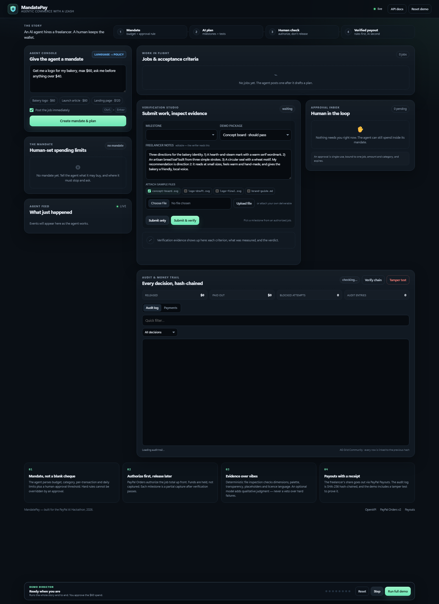

# MandatePay

**Agentic commerce with a leash.**

[](https://github.com/nattypatty-beep/paypalhack/actions/workflows/ci.yml)


> ### ▶ [Try the live demo](https://mandatepay-byfz.onrender.com/)
>
> <https://mandatepay-byfz.onrender.com/> — no login, no credentials, no install.
> Open it, click **Run full demo**, and approve the $60 hold when asked. The first
> request can take 30–60 seconds while Render's free instance wakes up.

MandatePay is an AI procurement agent that can hire freelancers — but only inside
a human-set **mandate**. The agent parses a plain-English instruction into a
budget, category, per-transaction and daily limits, and an approval threshold. It
drafts a milestone plan, authorizes a PayPal payment without capturing it,
verifies delivered work against machine-checkable criteria, and releases money
milestone by milestone.

The point is the **leash**: an AI agent should be able to move money without
being trusted with a blank cheque.



> Runs offline out of the box with a deterministic mock PayPal adapter and rules
> planner/verifier. Add sandbox credentials to switch to real PayPal Orders,
> authorizations, partial captures and Payouts. Live money requires an explicit
> `ALLOW_LIVE=1` opt-in.

Built for the **PayPal AI Hackathon 2026**.

---

## Table of contents

- [The 60-second story](#the-60-second-story)
- [Why this matters](#why-this-matters)
- [What is in the box](#what-is-in-the-box)
- [Quickstart](#quickstart)
- [Deploy a public demo](#deploy-a-public-demo)
- [Configuration](#configuration)
- [How the money works](#how-the-money-works)
- [Mandate rules](#mandate-rules)
- [Approvals are capabilities](#approvals-are-capabilities)
- [Verification: evidence over vibes](#verification-evidence-over-vibes)
- [AG Grid audit log](#ag-grid-audit-log)
- [API](#api)
- [Demo director](#demo-director)
- [Architecture](#architecture)
- [Project structure](#project-structure)
- [Tests and development](#tests-and-development)
- [Troubleshooting and FAQ](#troubleshooting-and-faq)
- [Data, reset and privacy](#data-reset-and-privacy)
- [Hackathon track alignment](#hackathon-track-alignment)
- [Safety and limitations](#safety-and-limitations)
- [Documentation](#documentation)
- [License](#license)

---

## The 60-second story

1. **A human gives the agent a mandate.**

   ```text
   Get me a logo for my bakery, max $60, ask me before anything over $40.
   ```

2. **The agent tries to overspend.**
   A $75 rush job is **hard-blocked** with `budget_exceeded`. No approval can
   override the budget cap.

3. **The agent revises to $60.**
   That is inside the budget but over the $40 threshold, so the job pauses in the
   **human approval inbox**.

4. **The human approves the hold.**
   PayPal authorizes the funds. Nothing is captured yet.

5. **The verifier checks the work.**
   The concept board passes, a placeholder draft is rejected with evidence, the
   final vector passes, and the brand kit passes.

6. **Money moves only after verification.**
   Each accepted milestone is a partial capture; the freelancer is paid via PayPal
   Payouts. Every decision is appended to a SHA-256 hash chain shown in AG Grid.

Run the whole scripted story from the **Demo director** at the bottom of the page.

---

## Why this matters

Agentic commerce has an awkward gap: giving an autonomous agent a checkout button
is either useless (a human approves every cent) or reckless (the agent has your
card). MandatePay proposes a middle layer:

- **Machine-enforced limits** that an approval cannot override.
- **Human approval as a capability**, not a blanket permission: single-use, bound
  to one job, amount and category, with a short expiry.
- **Escrow-style settlement**: authorize up front, capture only after objective
  verification.
- **A tamper-evident receipt** for every action, because "the agent did it" is not
  an audit trail.

The result is a reusable safety pattern for any agent that spends money:
freelancer procurement today, cloud spend, ad budgets, data purchases or API
credits tomorrow.

---

## What is in the box

| Area | Implementation |
| --- | --- |
| Agent instruction parsing | Deterministic rules parser, optional LLM fallback |
| Milestone planning | Deterministic templates, optional LLM JSON plan with budget repair |
| Mandate engine | Budget, category, expiry, per-transaction, daily, threshold, approval binding |
| Payments | PayPal Orders v2 authorize, partial capture, void; PayPal Payouts |
| Work verification | File inspection (formats, dimensions, colours, transparency, placeholders, text) + optional LLM judgment |
| Audit log | Append-only SQLite with SHA-256 hash chain and a tamper-test button |
| UI | Vanilla JS + CSS, no build step; AG Grid Community v36 vendored locally |
| Offline mode | Mock PayPal + deterministic rules engines; no network required |
| Public demo | Dockerfile, Render blueprint and optional HTTP Basic auth |
| Tests | 53 pytest tests covering rules, planner, verifier, API flow, auth and tamper detection |
| Docs | Architecture, PayPal setup, deployment, timed demo script, Devpost copy, security policy |

### What is mocked vs real

| Capability | Default (no credentials) | With sandbox credentials |
| --- | --- | --- |
| PayPal orders and authorizations | Deterministic local mock | Real PayPal sandbox Orders v2 |
| Captures and voids | Local state machine | Real PayPal Payments v2 |
| Payouts | Deterministic success | Real PayPal Payouts batch |
| Webhooks | Audited; trusted only if `PAYPAL_WEBHOOK_ID` is set | Signature verified against PayPal |
| Mandate engine | Real code | Same real code |
| Verification | Real rules engine | Same rules + optional LLM |
| Audit chain | Real SHA-256 chain | Same real chain |

The header always shows which engines are live: **PayPal mock** vs **PayPal
sandbox**, and **Rules engine** vs the configured model. No key means no
fictional AI claims.

---

## Quickstart

**Just want to try it?** Open the hosted demo — no install or credentials:

**<https://mandatepay-byfz.onrender.com/>**

Click **Run full demo** and approve the $60 hold when the modal appears.

**Prefer to run it locally?** Requirements: Python 3.11+ (tested on 3.13). No Node,
no database server, no build step, no credentials.

### Windows (PowerShell)

```powershell
git clone https://github.com/nattypatty-beep/paypalhack.git
cd paypalhack
powershell -ExecutionPolicy Bypass -File .\start.ps1
```

### macOS / Linux

```bash
git clone https://github.com/nattypatty-beep/paypalhack.git
cd paypalhack
chmod +x start.sh
./start.sh
```

### Manual

```bash
git clone https://github.com/nattypatty-beep/paypalhack.git
cd paypalhack
python -m venv .venv
# Windows: .venv\Scripts\activate
source .venv/bin/activate
pip install -r requirements.txt
python -m uvicorn app.main:app --host 127.0.0.1 --port 8000 --reload
```

Open <http://127.0.0.1:8000>. The app starts in mock mode and creates
`data/mandatepay.sqlite3` on first launch.

### First five minutes

1. Look at the header: it should say **PayPal mock** and **Rules engine**.
2. Click **Run full demo** in the Demo director.
3. Approve the $60 hold when the modal appears.
4. Watch the concept board pass, the draft get rejected, the final pass, and the
   brand kit release the last payment.
5. Click **Verify chain**, then optionally **Tamper test** to see the chain break.
6. Click **Reset demo** to start over.

No account, API key or internet connection is required.

### Verify the install

```bash
pip install -r requirements-dev.txt
python -m pytest -q
python -m compileall -q app tests scripts
```

With the server running:

```bash
python scripts/smoke.py --base-url http://127.0.0.1:8000
```

The smoke script resets the demo before and after its checks, so it is safe
against a local instance.

---

## Deploy a public demo

A reference deployment is live at **<https://mandatepay-byfz.onrender.com/>**
(Render free plan, Docker, mock PayPal, rules engine, no auth).

The app is a long-lived FastAPI process with SQLite and local uploads, so it
needs a container host with a persistent disk — **not** Vercel, Netlify or GitHub
Pages. Supabase is optional and not required by the current `sqlite3` store.

The repository ships a `Dockerfile` and a Render blueprint:

[](https://render.com/deploy?repo=https://github.com/nattypatty-beep/paypalhack)

1. Open <https://render.com/deploy?repo=https://github.com/nattypatty-beep/paypalhack>
   or create a **New → Blueprint** from the repo.
2. Set `BASIC_AUTH_PASSWORD` when prompted. The username defaults to `judge`.
3. Wait for the Docker build and open the generated HTTPS URL.
4. Log in and click **Run full demo**.

`render.yaml` enables demo mode, forces the mock PayPal adapter, sets
`DATA_DIR=/data` and gates the site behind Basic auth. Render's free plan has an
ephemeral filesystem, so the demo resets when the service restarts; add the
commented disk block (and a paid instance) to keep state.

Any Docker host works:

```bash
docker build -t mandatepay .
docker run -d -p 8000:8000 -v mandatepay_data:/data \
  -e BASIC_AUTH_USER=judge -e BASIC_AUTH_PASSWORD='<strong password>' \
  mandatepay
```

Full instructions, Railway/Fly/VPS examples, SSE proxy notes, webhook setup and
a security checklist: [docs/DEPLOY.md](docs/DEPLOY.md).

> Public deployments should keep `PAYPAL_FORCE_MOCK=true` or use sandbox
> credentials. `ALLOW_LIVE` must stay unset/false. Basic auth is one shared login,
> not multi-user authorization; read [SECURITY.md](SECURITY.md) first.

---

## Configuration

Copy `.env.example` to `.env` only when you want to change a default. The app
loads `.env` automatically without a third-party dotenv dependency.

| Variable | Default | Purpose |
| --- | --- | --- |
| `APP_NAME` | `MandatePay` | Display name |
| `DATA_DIR` | `./data` | SQLite file and uploads |
| `SAMPLES_DIR` | `./samples` | Demo deliverables |
| `DEMO_MODE` | `true` | Enables reset, demo samples and tamper test controls |
| `MAX_UPLOAD_MB` | `8` | Upload size limit |
| `APPROVAL_TTL_MINUTES` | `30` | How long a human has to decide |
| `APPROVAL_TOKEN_TTL_MINUTES` | `20` | How long an approved token can be used |
| `BASIC_AUTH_USER` / `BASIC_AUTH_PASSWORD` | empty | Set both to enable HTTP Basic auth for a public demo |
| `PAYPAL_CLIENT_ID` / `PAYPAL_CLIENT_SECRET` | empty | Sandbox app credentials; empty means mock |
| `PAYPAL_ENV` | `sandbox` | `sandbox` or `live` |
| `PAYPAL_WEBHOOK_ID` | empty | Enables webhook signature verification |
| `PAYPAL_PAYOUTS_ENABLED` | `true` | Send freelancer payouts after capture |
| `PAYPAL_FORCE_MOCK` | `false` | Keep the mock even with credentials |
| `ALLOW_LIVE` | `false` | Required before live PayPal is used |
| `FREELANCER_NAME` | `Avery Quinn` | Display name for the payee |
| `FREELANCER_EMAIL` | `freelancer@example.com` | Payout receiver |
| `PLATFORM_FEE_BPS` | `0` | Basis points withheld from the freelancer |
| `LLM_PROVIDER` | `auto` | `auto`, `openai`, `anthropic`, `ollama`, `none` |
| `LLM_API_KEY` / `LLM_MODEL` | empty | Enable the optional AI planner/verifier |
| `LLM_BASE_URL` | provider default | OpenAI-compatible or Ollama endpoint |
| `LLM_TIMEOUT_SECONDS` | `40` | Model request timeout |
| `LLM_MIN_CONFIDENCE` | `0.7` | Minimum confidence for AI judgments |

Mode resolution:

```text
PAYPAL_FORCE_MOCK=true             -> mock
no client id or secret             -> mock
credentials + PAYPAL_ENV=live      -> live only if ALLOW_LIVE=1, else sandbox
credentials + PAYPAL_ENV=sandbox   -> sandbox
```

See [docs/PAYPAL.md](docs/PAYPAL.md) for sandbox accounts, Payouts permissions,
webhooks and troubleshooting.

---

## How the money works

```text
Mandate ──► AI plan ──► Job ──► Mandate engine
                                   │
                     ┌─────────────┼──────────────┐
                     ▼             ▼              ▼
                   BLOCK     REQUIRE APPROVAL   ALLOW
                 (hard cap)   (human says yes)    │
                                   │              ▼
                                   └──────► PayPal Orders: create + authorize
                                                     (funds held, not captured)
                                                              │
                              submission ──► verifier ────────┤
                                                │             │
                                             revise        pass
                                                │             ▼
                                                │      partial capture
                                                │             │
                                                │             ▼
                                                └────── PayPal Payout to freelancer
                                                              │
                                                              ▼
                                                   SHA-256 hash-chained audit row
```

- **Authorize first.** The job total is one authorization. It is not revenue yet.
- **Capture after verification.** Each accepted milestone captures its own amount;
  the final capture closes the authorization.
- **Cancel voids the hold.** A cancelled job releases whatever was not captured.
- **Approvals do not bypass hard rules.** They only unlock a spend that is above
  the human threshold and otherwise legal.
- **All money is integer cents.** No floats touch balances.
- **Every payment has a PayPal ID.** Authorizations, captures and payouts are
  stored with their receipts and shown in the payments grid.

The mock adapter implements the same state machine as the real API:

- an order can be authorized once;
- an authorization can only be captured while active;
- a capture cannot exceed the remaining authorized amount;
- partial captures update the remaining balance;
- a void closes the hold;
- payouts succeed deterministically.

---

## Mandate rules

| Rule | Behaviour |
| --- | --- |
| Budget | Blocks if spent + committed + pending + request exceeds the budget |
| Category | Blocks categories outside the mandate unless `any` |
| Expiry | Blocks after `expires_at` |
| Per transaction | Blocks a single request above the cap |
| Daily limit | Blocks authorizations whose 24-hour total would exceed the cap |
| Approval threshold | Requires a human approval for amounts **strictly greater than** the threshold |
| Approval binding | Single-use, tied to mandate + job + amount + category, with an expiry |
| Capture | Enforces remaining authorization, category and budget; does not re-trigger the approval threshold |
| Currency | Must match the mandate currency |
| Inactive mandate | Blocks all new authorizations |

Financial definitions:

| Field | Meaning |
| --- | --- |
| `spent_cents` | Captured payments (money actually released) |
| `committed_cents` | Authorized but not yet captured |
| `pending_cents` | Unexpired pending approvals |
| `available_cents` | `budget - spent - committed - pending` |
| `authorized_cents` | Total active authorizations |
| `payouts_cents` | Completed Payouts |

The engine is implemented in [`app/mandate.py`](app/mandate.py) and covered by
[`tests/test_mandate.py`](tests/test_mandate.py).

---

## Approvals are capabilities

An approval is not a boolean and not a blank cheque. It is a row bound to:

- one mandate;
- one job;
- one exact amount in cents;
- one category;
- a decision expiry (`APPROVAL_TTL_MINUTES`, default 30);
- a use-after-approval expiry (`APPROVAL_TOKEN_TTL_MINUTES`, default 20);
- a single `used_at` consumption timestamp.

That means:

- a stale "yes" cannot authorize a different job;
- a "yes" for $60 cannot authorize $75;
- the same approval cannot be replayed;
- an approval cannot rescue a hard-blocked spend;
- a pending approval reserves budget, so two simultaneous approvals cannot spend
  the last dollar twice;
- re-authorizing a job that is already waiting returns the existing approval
  instead of creating a duplicate.

The UI shows the amount, job, rule and expiry before the human clicks
**Approve & authorize**. Approving creates a PayPal hold; it does not release
money.

---

## Verification: evidence over vibes

The verifier is rules-first. It inspects the actual bytes of each deliverable:

- file format and extension;
- image/PDF dimensions;
- colour count in SVGs;
- full-bleed background vs transparency;
- placeholder terms (`lorem ipsum`, `placeholder`, `tbd`, ...);
- extracted text, word counts and required keywords;
- licence language and file counts;
- SVG script elements and DTD/entity declarations (rejected);
- file size;
- SHA-256 content hash.

An optional LLM can add qualitative judgment, but it **cannot turn a hard rule
failure into a pass**. If no model is configured, the UI says the qualitative
review was skipped instead of pretending otherwise.

The demo is engineered so you can see both sides:

| Package | Result | Why |
| --- | --- | --- |
| `concept-board.svg` | pass | 1000×700, 3+ directions, real rationale |
| `logo-draft.svg` | **revise** | 400×200, 11 colours, full-bleed, "PLACEHOLDER" + lorem ipsum |
| `logo-final.svg` | pass | 1200×400, 3 colours, transparent, real wordmark |
| `logo-final.svg` + `brand-guide.md` | pass | vector master + licence and usage notes |

When a milestone passes, the service captures the milestone amount and records a
payout. When it needs revision, the money stays held and the evidence stays
visible. A `human_review` criterion escalates instead of guessing.

---

## AG Grid audit log

The **Audit & money trail** panel is AG Grid Community v36, vendored at
`app/static/vendor/` so the demo has no CDN or Node dependency. It provides quick
filtering, a decision filter, sortable columns, an audit/payments tab switch, and
a plain HTML fallback if AG Grid cannot initialise.

Each audit row contains `prev_hash` and `hash`, where:

```text
body = {
  seq, id, ts, actor, action, subject_type, subject_id, decision,
  amount_cents, currency, reason_codes, message, meta, prev_hash
}
hash = SHA-256(canonical_json(body))
```

The first row links to 64 zeroes. **Verify chain** recomputes every link. **Tamper
test** alters the newest row in the database on purpose, then the next
verification reports the first broken sequence number. The same check is
available at `GET /api/audit/verify`.

The grid is the product's money trail, not decoration:

- filter by `allow`, `block`, `require_approval`, `error`, `info` or `proposed`;
- search a job title, PayPal ID or reason code;
- switch to **Payments** to see authorizations, captures and payouts;
- read the chain head and count from the header.

---

## API

Interactive OpenAPI docs: <http://127.0.0.1:8000/docs>. The UI uses the same
public API that a judge or an agent would.

| Method | Path | Purpose |
| --- | --- | --- |
| `GET` | `/api/health` | Engine mode, LLM status, chain health |
| `GET` | `/api/state` | Full dashboard state |
| `GET` | `/api/audit` | Audit rows plus chain verification |
| `POST` | `/api/command` | Parse an instruction, create a mandate + plan; `post:false` previews |
| `POST` | `/api/mandates` | Create a mandate from explicit fields |
| `POST` | `/api/jobs` | Post a job with an optional plan |
| `POST` | `/api/jobs/{id}/authorize` | Run the mandate engine, then authorize with PayPal |
| `POST` | `/api/jobs/{id}/cancel` | Void the remaining authorization |
| `GET` | `/api/approvals/{id}` | Read one approval request |
| `POST` | `/api/approvals/{id}/resolve` | Approve or reject a threshold spend |
| `POST` | `/api/spend/check` | Spend simulator / policy dry run |
| `POST` | `/api/milestones/{id}/submissions` | Submit work |
| `POST` | `/api/submissions/{id}/verify` | Verify and settle if it passes |
| `POST` | `/api/milestones/{id}/release` | Human override release |
| `POST` | `/api/demo/milestones/{id}/submit` | Submit a prebuilt demo package |
| `POST` | `/api/uploads` | Upload a deliverable |
| `GET` | `/api/uploads/{id}/content` | Serve an uploaded deliverable |
| `GET` | `/api/audit/verify` | Recompute the hash chain |
| `POST` | `/api/audit/tamper` | Demo-only tamper test |
| `POST` | `/api/demo/reset` | Reset the demo database |
| `GET` | `/api/stream` | Server-sent events for live updates |
| `POST` | `/api/webhooks/paypal` | PayPal webhook receiver with signature verification |

Example — preview a mandate without posting a job:

```bash
curl -s http://127.0.0.1:8000/api/command \
  -H "Content-Type: application/json" \
  -d '{"text":"Get me a logo for my bakery, max $60, ask me before anything over $40.","post":false}'
```

Example — inspect the audit chain:

```bash
curl -s http://127.0.0.1:8000/api/audit/verify
```

All amounts in requests and responses are integer cents. The API returns stable
JSON errors through a `ServiceError` handler; unexpected errors do not leak stack
traces to the client.

---

## Demo director

The bottom panel runs eight stages against the public API:

| Step | What it does | What to notice |
| --- | --- | --- |
| 1. Draft the mandate & plan | Parses `$60` and `$40`, drafts three milestones | Plan sums to the budget |
| 2. Probe the budget with $75 | Creates and authorizes a $75 job | Hard block, no approval offered |
| 3. Post the $60 job | Creates the real job and requests authorization | Approval modal opens |
| 4. Verify concept directions | Submits `concept-board.svg` | Pass and first capture |
| 5. Catch a weak draft | Submits `logo-draft.svg` | Revise; money stays held |
| 6. Release the logo master | Submits `logo-final.svg` | Pass and second capture |
| 7. Release the brand kit | Submits vector + guide | Pass and final capture |
| 8. Verify the hash chain | Recomputes every audit link | 23 rows, zero breaks |

You can also click **Step** to run one stage at a time, or **Reset** for a fresh
mandate and hash chain. The full run takes about two minutes. A timed recording
script is in [docs/DEMO_SCRIPT.md](docs/DEMO_SCRIPT.md).

---

## Architecture

```text
Browser (vanilla JS + AG Grid)
        │ JSON + SSE
        ▼
FastAPI routes (app/main.py)
        ▼
AppService (app/service.py)
   ├─ MandateEngine  app/mandate.py
   ├─ Planner        app/planner.py + app/nlp.py
   ├─ Verifier       app/verify.py + app/inspect.py
   ├─ PayPalClient   app/paypal.py (real or mock)
   └─ Store          app/store.py (SQLite + hash-chained audit)
```

- **No build step.** Static files are served by FastAPI.
- **One process.** SQLite with WAL-friendly transactions; no broker or worker.
- **Server-authoritative.** The browser renders state and invokes endpoints; it
  cannot approve a spend by changing local state.
- **Optional AI.** Rules remain correct when the model is slow, wrong or absent.
- **Honest modes.** Mock vs sandbox and rules vs LLM are explicit in the UI.

Full design notes, invariants and extension points:
[docs/ARCHITECTURE.md](docs/ARCHITECTURE.md).

---

## Project structure

```text
app/
  main.py        FastAPI routes, SSE, uploads, webhooks
  service.py     Orchestration: command, jobs, approvals, verification, settlement
  mandate.py     The spend policy engine
  planner.py     Deterministic + optional LLM milestone planning
  verify.py      Rules-first verification and AI merge guardrail
  inspect.py     File metadata, colour, dimension and placeholder inspection
  paypal.py      Orders v2, Payouts, webhook verification, deterministic mock
  store.py       SQLite schema, financials, hash-chained audit
  nlp.py         Natural-language mandate parser
  llm.py         Optional OpenAI/Anthropic/Ollama client
  models.py      Pydantic models and enums
  money.py       Integer-cent helpers and formatting
  config.py      Environment-driven settings
  events.py      In-process SSE event bus
  util.py        Time, IDs and canonical JSON helpers
  static/        Vanilla UI, styles, app.js, vendored AG Grid
samples/         Demo deliverables engineered to pass or fail
tests/           53-test pytest suite
docs/            Architecture, PayPal, deployment, demo script, Devpost copy, screenshot
scripts/         Smoke test
Dockerfile       Non-root production image with a /data volume
render.yaml      Render blueprint: demo mode, mock PayPal, Basic auth
.github/         CI (tests, smoke, Docker build), Dependabot, issue and PR templates
```

---

## Tests and development

```bash
pip install -r requirements-dev.txt
python -m pytest
```

Coverage includes:

- strict threshold semantics, hard blocks, category/per-transaction/daily/expiry;
- single-use approvals and amount/job binding;
- capture limits against the remaining authorization;
- planner budget-sum invariant across categories and budgets;
- mock-PayPal end-to-end flow: block → approve → authorize → reject draft → release;
- audit chain verification and tamper detection;
- optional Basic auth: protected paths, health/webhook exemptions and malformed headers;
- objective sample inspection and malformed-file handling.

Useful commands:

```bash
python -m pytest -q
python -m pytest -q -k approval
python -m compileall -q app tests scripts
python -m uvicorn app.main:app --reload
python scripts/smoke.py --base-url http://127.0.0.1:8000
```

Development conventions, invariants and PR expectations are in
[CONTRIBUTING.md](CONTRIBUTING.md).

---

## Troubleshooting and FAQ

### The header says "PayPal mock" even though I set credentials

Check that both `PAYPAL_CLIENT_ID` and `PAYPAL_CLIENT_SECRET` are set, that
`PAYPAL_FORCE_MOCK` is not `true`, and that you restarted the server. The startup
log prints the resolved mode.

### PayPal says it cannot get an access token

The client ID/secret are wrong or belong to a different environment. Regenerate
sandbox credentials at
<https://developer.paypal.com/dashboard/applications/sandbox>.

### Payouts fail with a permission or funds error

Payouts are a separate PayPal product. Confirm the sandbox app owner is enabled
for Payouts and has balance. If Payouts are unavailable, set
`PAYPAL_PAYOUTS_ENABLED=false`: captures still work and the audit log records
`payout.skipped` rather than pretending money moved.

### The LLM is not being used

Set a provider, model and key (or point `LLM_BASE_URL` at Ollama). With the
default `LLM_PROVIDER=auto`, a key + model selects OpenAI. The UI and `/api/health`
show whether a model is active. A failed or low-confidence model response falls
back to the rules engine.

### Port 8000 is already in use

```bash
python -m uvicorn app.main:app --host 127.0.0.1 --port 8001
```

### The demo state looks wrong

Click **Reset demo** in the header or call:

```bash
curl -X POST http://127.0.0.1:8000/api/demo/reset
```

### The audit chain is broken

If you clicked **Tamper test**, that is intentional. Reset the demo to recreate a
clean chain. If the chain breaks without tampering, check whether another process
wrote to the SQLite file or restored an old copy.

### Windows refuses to run `start.ps1`

Use the documented bypass:

```powershell
powershell -ExecutionPolicy Bypass -File .\start.ps1
```

### Do I need a PayPal account or API key?

No. The default demo is fully offline. A sandbox account is only needed to see
the real Orders/Payouts calls.

### Is this moving real money?

No, not by default. It uses a deterministic mock adapter. Sandbox mode uses fake
sandbox money. Live mode requires `PAYPAL_ENV=live`, real credentials **and**
`ALLOW_LIVE=1`.

### Is an approval a blank cheque?

No. It is single-use and bound to one mandate, job, exact amount and category,
with two expiries. It cannot override budget, category, per-transaction or expiry
blocks.

### Why does the draft get rejected?

Because the verifier reads the bytes: `logo-draft.svg` is 400×200, has 11
colours, a full-bleed background, and "PLACEHOLDER" plus lorem ipsum. The criteria
require a larger, simpler, transparent, placeholder-free master.

### Can I use this in production?

No. It is a hackathon prototype with only optional shared Basic auth — no user
accounts, tenant isolation, malware scanning, refunds, reconciliation or legal
escrow. Read
[SECURITY.md](SECURITY.md) before deploying anywhere.

### Why AG Grid?

Because the audit trail is the product. A judge should be able to filter by
decision, search a job, switch to payments, and see that every row is linked to
the previous hash — not scroll a raw JSON dump.

### Why SQLite?

One file, zero setup, easy to inspect with any SQLite browser. The store layer is
small and the schema is explicit; swapping it for Postgres would not change the
service logic.

### Are amounts floats?

No. Every amount is an integer number of cents. Formatting happens only in
`app/money.py`.

### What happens if the process crashes between capture and payout?

The capture and payout are separate PayPal operations. The app records the
capture, attempts the payout, and writes an explicit failure row if the payout
fails. A production system needs a reconciliation worker; the audit trail is
designed to show the gap rather than hide it.

---

## Data, reset and privacy

- Runtime data lives in `data/mandatepay.sqlite3` and `data/uploads/`.
- Both are git-ignored and never committed.
- The demo reset endpoint clears mandates, jobs, milestones, submissions,
  approvals, payments, audit rows, mock PayPal objects and uploads.
- Uploaded files are stored locally with generated names, not user paths.
- The app has no analytics, telemetry or external calls in mock mode.
- PayPal and LLM credentials are read from the environment and never written to
  the audit log.
- `DEMO_MODE=false` disables reset and tamper endpoints for a less playful
  deployment.

---

## Hackathon track alignment

- **Best Use of Agentic Commerce** — an agent that can transact, with policy,
  approvals, verification and settlement as first-class primitives.
- **Best Use of PayPal + AI** — PayPal Orders authorizations, partial captures,
  Payouts and webhook verification wrapped around AI planning and verification.
- **Best Use of AG Grid** — the audit/payments grid is the money trail, not
  decoration; quick filter, decision filter and hash-linked rows.
- **Most Impactful** — a reusable safety layer for any agent that spends money.
- **Most Creative** — "authorize, don't release" as the core interaction.
- **Grand Prize** — working software, honest mock fallbacks, tests, docs and a
  sub-three-minute scripted demo.

The full submission copy is in [docs/DEVPOST.md](docs/DEVPOST.md).

---

## Safety and limitations

- Sandbox by default. Live PayPal is blocked behind `ALLOW_LIVE=1` **and**
  credentials.
- The mock adapter is deterministic and must never be confused with real money;
  the UI labels it clearly.
- The audit chain proves internal consistency, not external notarization. A
  production deployment would anchor hashes to an append-only external store.
- Uploaded files are stored locally and served with a restrictive content policy.
  A production deployment needs malware scanning, object storage and per-tenant
  isolation.
- HTTP Basic auth is optional and off by default. It is a single shared login,
  not per-user authorization. Enable it before exposing the demo publicly, and
  add real identity/tenant controls before handling anyone else's money.
- There is no refund, dispute or chargeback workflow. Cancelling voids the
  remaining authorization; it does not refund captured money.
- This is a hackathon prototype, not a licensed escrow or money-transmission
  service.

See [SECURITY.md](SECURITY.md) for the threat model, controls, known limitations
and safe-deployment checklist.

---

## Documentation

- [Architecture](docs/ARCHITECTURE.md) — components, invariants, data model,
  settlement flow, extension points.
- [Deployment](docs/DEPLOY.md) — Render, Railway, Fly.io and Docker, persistent
  storage, Basic auth, webhooks, SSE and a public-demo security checklist.
- [PayPal integration](docs/PAYPAL.md) — sandbox setup, exact API calls,
  idempotency, webhooks, live guardrails, troubleshooting.
- [Demo script](docs/DEMO_SCRIPT.md) — timed shot list for a sub-three-minute
  video, narration and fallback steps.
- [Devpost submission copy](docs/DEVPOST.md) — ready-to-paste project story,
  built-with list and track fit.
- [Contributing](CONTRIBUTING.md) — setup, code invariants, tests, PR checklist.
- [Code of Conduct](CODE_OF_CONDUCT.md)
- [Security](SECURITY.md)
- [Third-party notices](THIRD_PARTY_NOTICES.md) — AG Grid MIT text and dependency
  licenses.

## License

MIT — see [LICENSE](LICENSE).

MandatePay is not affiliated with or endorsed by PayPal. PayPal and the PayPal
logo are trademarks of PayPal, Inc. The "Hearth & Crumb" bakery in the demo is
fictional.
